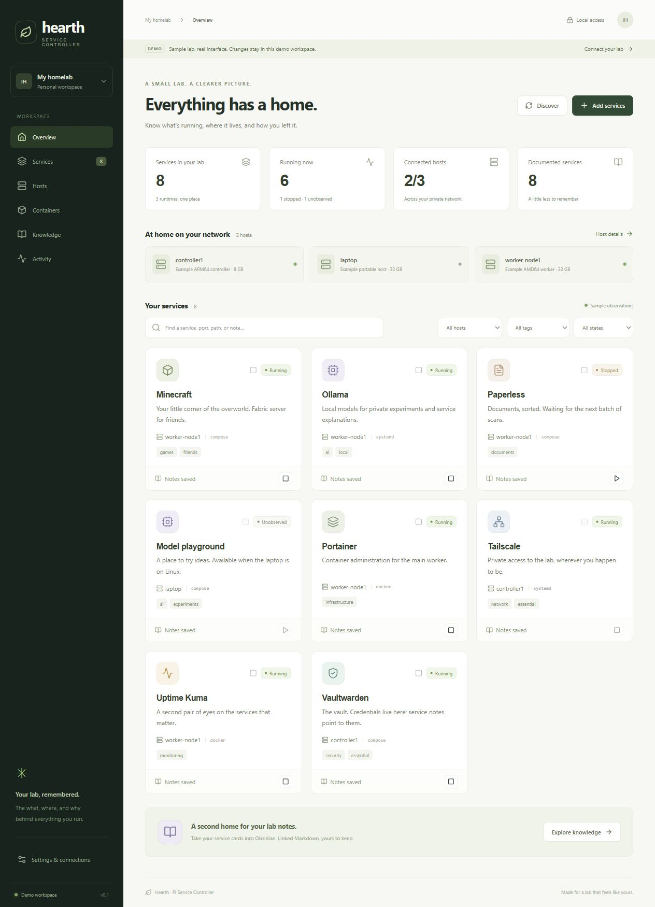

# Hearth Service Controller

A self-hosted, service-first homelab dashboard that remembers what runs where, how it was installed, where its configuration lives and how to investigate failures.

**Experimental public source.** CI verifies fixtures and mocked providers; real deployment and the first phone-to-service control remain unverified. Feature counts describe source/workflow coverage, not production readiness. Start with the [first deployment acceptance](docs/FIRST-DEPLOYMENT.md). Demo names, addresses and hardware labels are illustrative, not a contributor's network inventory.

Hearth is the working interface name. The controller serves a React/TypeScript PWA and keeps a SQLite registry, linked Markdown notebooks, configuration history and action evidence. Optional agents expose explicitly approved operations on Linux, macOS and Windows.



## Features

- Reviewed Docker/Compose/systemd/pm2/process discovery, service grouping and dependency-aware controls.
- Service notebooks, owner notes, installation/recovery documentation, portable manifests and conflict-aware Obsidian sync.
- Health checks, observed uptime/incidents, resource history, sustained thresholds and opt-in notifications.
- Approved file previews and configuration editing, prospective Git snapshots, diffs and reviewed restores.
- Bounded read-only streams, optional interactive terminals and private opt-in recordings, installation comparisons and explicit history reconstruction.
- Scoped credential findings and owner vault references; advice-only local AI drafts and explanations.
- Confirmed configured Wake-on-LAN and guarded suspend/shutdown requests with durable uncertain-outcome holds.
- Opt-in individual/application schedules with IANA timezones, daylight-saving rules, fresh-state guards and no offline backlog.
- Approved restic backup profiles, manual/daily/weekly policies, snapshot previews, safety snapshots and guided restore. See [backup scope and setup](docs/BACKUPS.md); real NAS/application recovery remains unverified.
- Cross-platform software/startup metadata with curated documentation links; optional owner password/TOTP login and independently signed agent transport.
- Semantic action history plus a durable API write journal for accepted/refused/interrupted requests. Journal records contain fixed route templates and outcome metadata, without bodies, query strings or credentials.

The [complete feature list](docs/FEATURE-LIST.md) preserves every original140 feature and three requested additions. The [status ledger](docs/FEATURE-STATUS.md) lists implemented scope and missing work. The [test matrix](docs/FEATURE-TEST-MATRIX.md) defines valid, invalid and null/edge cases for all143 entries, with real behavioral-test references and recorded execution evidence. Planned features are not reported as passing.

## Run the isolated demo

Use Python3.13 and Node22.12+ or a compatible newer Node version. Git is needed for configuration history. From the repository root:

```sh
python -m venv .venv
# Activate the virtual environment using your shell's normal activation command.
python -m pip install -r requirements-dev.txt
cd web
npm ci
npm run build
cd ..
python -m controller --demo
```

Open [localhost:8787](http://127.0.0.1:8787). Every demo control is simulated; no agent, native command, model, notification or wake packet is contacted. Demo schedules can be saved/previewed but do not dispatch automatically. Sample hosts, paths, states and metrics are illustrative.

On Windows with an existing environment:

```powershell
.\.venv\Scripts\python.exe -m controller --demo
```

Only one controller can listen on a port. Demo storage is `data/demo/`; a live registry uses `data/live/`. Existing data is preserved across starts. Neither mode installs services or grants operating-system privileges.

## Architecture

```text
Browser / installable PWA
    │ same-origin REST and bounded streams
Controller: FastAPI · SQLite · Markdown · configuration Git history
    │ bearer auth + optional independent signing/replay protection
Approved host agents: fixed runtimes · paths · profiles · native adapters
```

The controller is independent of agent imports. The deployment image copies `controller/` and `shared/`; the agent runs separately on each approved host. See [platform support](docs/PLATFORM-SUPPORT.md), [manual platform checks](docs/MANUAL-PLATFORM-CHECKS.md) and [scope contracts](docs/POWER-AND-SCHEDULES.md).

## Connect an agent

1. Collect a read-only target report with an existing interpreter: `python3 scripts/platform_check.py`.
2. Review the appropriate disabled-by-default example in `deploy/`. Keep private configuration in an ignored `*.local.yaml` file.
3. Provision `PSC_AGENT_TOKEN` privately. If signing is enabled, provision its independent key and an existing private `state_dir` as described in the agent example.
4. Start the agent as an ordinary account on loopback or its verified Tailscale address:

   ```sh
   python -m agent.app --config deploy/agent.local.yaml --host 127.0.0.1 --port 8788
   ```

5. Start the live controller with `python -m controller`. Configure the host with environment-variable **names**, stable physical identity and its agent URL; provision matching values privately outside the registry.
6. Review discovery before accepting services. Runtime/file/terminal/secret-scan/power permissions are separate local opt-ins. Documenting a path grants no access to it.

Remote controller binding requires private ingress and owner authentication. Startup refuses broad/public listeners; use verified Tailscale identity or a private HTTPS proxy over loopback. Never expose the controller directly to the public internet. OS privileges, Docker socket access, macOS Automation permission and Windows power rights need separate owner-reviewed setup. The application does not apply them automatically.

## Safety and data

- Store credential values in private environment/vault mechanisms. Registry records hold references. Redaction/detection is best-effort.
- Approved file roots must be owner-controlled. Secret-bearing file previews/history stay excluded; linking a vault item does not make a file safe.
- Runtime/config/terminal/power operations reserve their host. Unknown results require observation/inspection; they are not automatically retried.
- Power affects all user sessions and unregistered applications. Plans show registered services and declared dependent impact; no forced closure or inhibitor bypass is used.
- A terminal's working directory is not a filesystem sandbox. Content recordings require explicit opt-in and cannot guarantee comprehensive secret removal.
- Configuration restore creates a new version and never silently restarts a service. Backup restore is separately confirmed, creates a current-data safety snapshot, and can restart an originally running service. Interrupted operations stay held for inspection.
- PWA caching includes only the public app shell, never API data, credentials, logs, files or commands. Offline controls are unavailable.
- Data, caches, private local configs, environment files, keys and internal continuation notes are excluded by `.gitignore`. Review the prospective file list before publishing; Git initialization does not publish anything.

## Tests and feature traceability

```sh
cd web
npm run build
npm run test:pwa
npm run test:appearance
cd ..
python -m pytest --basetemp=.cache/local-tests --junitxml=.cache/backend.xml
python scripts/feature_report.py
python scripts/feature_test_report.py --junit .cache/backend.xml
```

Build the public app shell before backend tests. Use a fresh temporary test directory for each run. Backend fixtures use isolated databases and mocked agents/native/network/model providers. Appearance tests cover valid settings, invalid settings and null/corrupt storage. Browser acceptance covers layout and actual interaction in a separate synthetic workspace. The 429 matrix cases are scenario definitions linked to behavioral assertions; shared integration tests can exercise multiple scenarios. Native target checks and planned-feature cases remain clearly identified. The report only marks evidence supplied to that run as passed; without Node/browser results those cases remain unverified.

GitHub Actions definitions run mocked backend checks on Windows/Linux/macOS and build/test the frontend after the repository is pushed. Those workflows are prepared locally; no GitHub run or native target deployment is claimed.

## Platform verification and roadmap

Current ledger: **115 Done, 6 Partial (native verification deferred), 22 Not started** across 143 features. The full list and three-case evidence matrix are linked above. These are source/workflow assessments; the first real deployment is still pending.

Six target-dependent rows are deferred at the owner's request: native file-edit behavior, restricted OS privileges, Ubuntu/CachyOS installation, ARM64/AMD64/Pi resource validation, broad-telemetry resource measurement and native macOS compatibility. Read-only platform reports come first. Mock success is not deployment evidence, and an older Mac may lack compatible Python/dependencies.

Broader feature work is paused until the six deferred platform checks have target evidence. Remaining planned entries include boot policies, vault verification, Kuma/platform/security integrations, application installation and Kubernetes/Proxmox support. The complete ledger retains discussion/later items instead of silently dropping them.

## License

Released under the [MIT license](LICENSE). Third-party dependencies retain their respective licenses.
